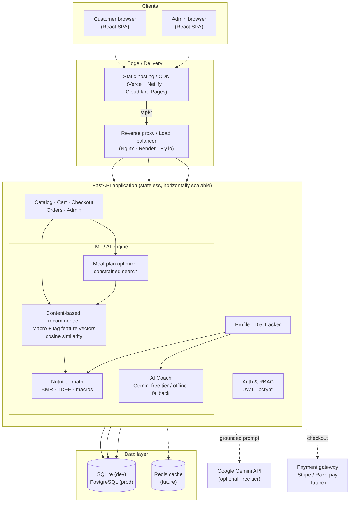

# NutriAgent — Project Report

> AI-powered personalized nutrition & meal-planning system (full-stack: React · FastAPI · SQL · ML)

## 1. What real-world problem is this?

Generic diet advice fails because nutrition needs are individual, and the tools people use are fragmented:

| Pain point | Reality today |
|---|---|
| **One-size-fits-all plans** | A 68 kg woman cutting fat and an 90 kg man bulking get the same "1,800 kcal" template. |
| **Planning → buying gap** | Apps tell you *what* to eat; you then manually shop for it elsewhere. Most plans are abandoned within weeks. |
| **Safety** | Allergies and diets (vegan, keto, gluten-free) are easy to get wrong when picking food manually. |
| **No feedback loop** | Tracking in one app, shopping in another, advice in a third — nothing learns from what the user actually eats and buys. |
| **Platform lock-in** | Meal-kit companies, gyms, clinics and corporate-wellness programmes each rebuild the same stack from scratch. |

Diet-related conditions (obesity, type-2 diabetes, hypertension) are among the most common long-term health burdens worldwide, and personalised guidance that is cheap to deliver is a real need.

## 2. Our solution

NutriAgent closes the loop **profile → targets → recommendation → plan → purchase → tracking → coaching** in one platform.

1. **Nutrition engine** — Mifflin-St Jeor BMR → TDEE (activity factor) → goal-adjusted calories (−20 % lose / +15 % gain, with a safety floor of 1,200/1,500 kcal) → protein by body weight, fat share, carbs as remainder. Keto uses its own split.
2. **Recommender (ML)** — every catalog item becomes a feature vector (macro energy shares, calorie density, fibre density, 11 diet tags, item kind). The user is a *preference vector*: the ideal macro profile from their targets and goal, blended 70/30 with the centroid of items they previously bought or logged (implicit feedback). Items are ranked by **cosine similarity** after **hard filters** for diet and allergens. Each result carries human-readable reasons ("Free of your allergens", "34 g protein").
3. **Meal-plan optimiser** — for each meal slot, takes the top-K recommended candidates (each with its best serving size) and exhaustively searches slot combinations to minimise a weighted squared error against the day's calorie/protein/carb/fat targets, plus a variety penalty so the same meal isn't repeated daily. One click adds the whole plan to the cart.
4. **Commerce** — catalog with search/filters (diet, allergens, calories, protein), cart with allergen/diet warnings, checkout with stock validation and atomic inventory decrement, order history.
5. **Diet monitoring** — food log (catalog or custom foods), progress vs targets, 7-day chart, weight trend.
6. **AI coach** — answers questions grounded in the user's *own computed data*. Uses Google's free Gemini tier if a key is set; otherwise a deterministic offline coach, so the app always works at zero cost.
7. **Admin console** — dashboard (revenue, orders, top sellers, low stock), product CRUD, order status workflow (cancel → restock), user management.

**Measured on the seeded catalog (46 items):** the planner's day-level "match score" (my own metric: closeness of daily calories and protein to target, 0–100) averaged **86–98** across 9 goal × diet combinations tested (lose/maintain/gain × any/vegan/keto), and all six diets produce valid 3-day plans in the automated tests. Note this is a fit-to-target measure on a small demo catalog, *not* a clinical-outcome claim.

## 3. Who are the end users?

| Persona | How they use it |
|---|---|
| **Health-conscious individuals** (fat loss, muscle gain, maintenance) | Profile → weekly plan → one-click order → daily tracking |
| **People with dietary restrictions / allergies** | Safe filtering and warnings on every surface |
| **Busy professionals** | Skip planning; the optimiser plans and the cart buys |
| **Store / platform operators** (meal-kit brands, health-food stores, gyms, cafeterias) | Admin panel for catalog, stock, orders, customers |
| **Dietitians / coaches** *(extension)* | Same engine, multi-client dashboard |

Because branding, currency and catalog are configuration/data (not code), the same codebase works as a **meal-delivery store, supplement shop, grocery planner, corporate-wellness portal, or hospital diet-monitoring system**.

## 4. Scalability (system-level architecture)

**Design properties that make it scale**

* **Stateless API** — auth is JWT, no server-side sessions, so any number of identical API containers can sit behind a load balancer.
* **Separated tiers** — static React bundle can be served from a CDN; API and DB scale independently.
* **Portable data layer** — SQLAlchemy 2.0 ORM; SQLite for dev, PostgreSQL by changing one env var (`DATABASE_URL`). Tags/allergens use portable JSON columns.
* **Cheap ML** — recommender and optimiser are in-process NumPy/scikit-learn with no GPU and no model server. The LLM is optional and external, so it adds no infrastructure.

**Measured (single-user, sequential, one small container, SQLite, 46 items — not a load test):**

| Endpoint | Median | p95 |
|---|---|---|
| `GET /api/products` (page of 12) | 3.5 ms | 4.2 ms |
| `GET /api/products/recommended` | 6.9 ms | 7.8 ms |
| `POST /api/planner/generate` (7 days) | 55 ms | 57 ms |
| `POST /api/planner/generate` (14 days) | 97 ms | 102 ms |

**Honest limits of the current build, and the upgrade path**

| Today | Bottleneck at scale | Upgrade |
|---|---|---|
| Tag/allergen filters run in Python after the SQL query | Catalog of 10⁴–10⁵ items | PostgreSQL JSONB + GIN index, or a tags join table; Elasticsearch/Meilisearch for text search |
| Recommender rebuilds product vectors per request | Per-request CPU | Pre-compute vectors on product change; cache in Redis; ANN index (FAISS) for large catalogs |
| Planner is CPU-bound (≈55 ms/7 days) | Concurrent plan requests | Run in a worker queue (Celery/RQ), or cache by (targets, diet, allergens) |
| Single process | Throughput | `gunicorn -k uvicorn.workers.UvicornWorker -w N` + horizontal replicas + connection pooling (PgBouncer) |
| Checkout is synchronous, mock payment | Reliability | Stripe/Razorpay + webhooks, idempotency keys, row-level locking on stock |
| Orders/logs in one DB | Write volume | Read replicas for dashboards; partition `food_logs` by date |

## 5. Is it cost-effective? Future scope

**Cost — build and run: ₹0 / $0 to start**

| Layer | Free choice |
|---|---|
| IDE | VS Code |
| Frontend | React + Vite, Recharts (all open source) |
| Backend / ML | FastAPI, SQLAlchemy, scikit-learn, NumPy (open source) |
| DB | SQLite locally; free managed Postgres tiers exist (Neon, Supabase) |
| LLM | Gemini API free tier (optional) — offline coach needs nothing |
| Hosting | Free tiers exist for static hosting and small web services (Vercel, Netlify, Render, Fly.io, Cloudflare Pages) |
| CI / repo | GitHub + GitHub Actions free tier |

Free-tier limits and model names change often — **check each provider's current terms** before relying on them. The architecture has no hard dependency on any paid service, and the LLM is behind a fallback, so an API outage or quota limit degrades gracefully instead of breaking the app.

Why it is cost-efficient at runtime: no GPU, no model hosting, tiny memory footprint, ML inference in milliseconds, and the only per-use external cost (LLM) is optional and can be rate-limited or cached.

**Future scope**

* Real payments (Stripe/Razorpay), coupons, subscriptions ("weekly plan box")
* Collaborative filtering once there is enough purchase data; learning-to-rank from add-to-cart/log signals
* Barcode scanning + open food databases (Open Food Facts / USDA FoodData Central) for tracking any food
* Photo-based meal logging with a vision model
* Wearable integration (steps/sleep) to adapt TDEE dynamically
* Micronutrient targets, medical-condition modes (diabetes, hypertension) **reviewed by a registered dietitian**
* Dietitian multi-client portal, notifications, i18n, mobile app (React Native)
* MLOps: offline evaluation of recommender (precision@k on held-out purchases), A/B testing, monitoring

## 6. Requirements

### Functional requirements

| ID | Requirement | Status |
|---|---|---|
| FR-1 | Users can register, log in, and log out (JWT) | ✅ |
| FR-2 | Separate administrator login with role-based access control | ✅ |
| FR-3 | Users maintain a health profile (age, sex, height, weight, activity, goal, diet, allergies, meals/day) | ✅ |
| FR-4 | System computes BMR, TDEE, calorie and macro targets | ✅ |
| FR-5 | Browse/search/filter/sort/paginate the catalog (diet, allergens, calories, protein, category) | ✅ |
| FR-6 | Product detail page with full nutrition breakdown and allergen warning | ✅ |
| FR-7 | Personalised recommendations with explanations | ✅ |
| FR-8 | Generate a multi-day meal plan respecting diet/allergies; regenerate; plan → cart | ✅ |
| FR-9 | Add / update / remove cart items with stock limits; cart shows totals and diet/allergen warnings | ✅ |
| FR-10 | Checkout with address + payment method (demo gateway), tax and shipping, stock decrement, order confirmation | ✅ |
| FR-11 | Order history for customers | ✅ |
| FR-12 | Food log, daily progress vs targets, 7-day history, weight log | ✅ |
| FR-13 | AI coach chat grounded in the user's data | ✅ |
| FR-14 | Admin: dashboard, product CRUD (soft delete), order status updates (cancel restocks), user enable/disable | ✅ |
| FR-15 | White-label branding/currency via configuration | ✅ |

### Non-functional requirements

| Category | Requirement | How it is met |
|---|---|---|
| **Security** | Passwords hashed; stateless auth; least privilege | bcrypt, signed JWT with expiry, `require_admin` dependency, every user-data query scoped by `user_id`; card numbers never stored |
| **Performance** | Interactive responses | Measured medians 3–7 ms for read endpoints, ~55 ms for a 7-day plan (see §4) |
| **Scalability** | Horizontal scale | Stateless API, DB-agnostic ORM, CDN-friendly SPA |
| **Reliability** | Consistent orders; graceful degradation | Single-transaction checkout with stock validation; LLM falls back to offline coach |
| **Usability** | Responsive, clear errors | Mobile breakpoints, field-level validation messages, toasts |
| **Maintainability** | Clean modular code, tests | Router/service/ML separation, 11 automated API tests, typed schemas (Pydantic) |
| **Portability** | Runs anywhere | Zero-config SQLite; Dockerfile + Compose for Postgres |
| **Cost** | Free to build and run | See §5 |
| **Privacy / safety** | Health data minimal; not a medical device | Disclaimers in UI and AI replies; calorie floor; no diagnosis |
| **Observability** *(planned)* | Logs/metrics | `/api/health` exists; add structured logging + Prometheus/Sentry |
